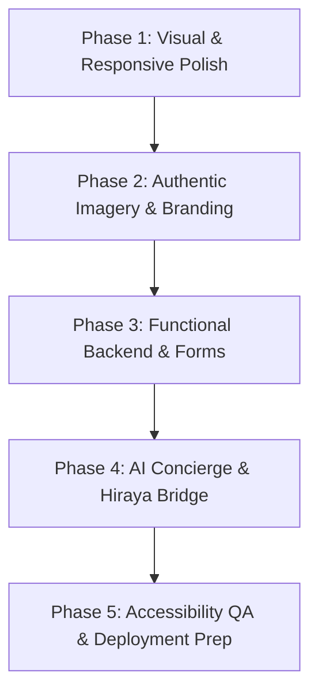

# Mission Villa Senior Living — Local Workspace Review & Development Roadmap

**Project:** Mission Villa Senior Living Website (`missionvilla-ui-new`)  
**Workspace Path:** `/home/rajthecypher/projects/mission-villa-senior-living/missionvilla-ui-new`  
**Parent Workspace:** `/home/rajthecypher/projects/mission-villa-senior-living`  
**Git Remote:** `https://github.com/Promotix21/missionvilla-ui-new.git`  
**Commit SHA:** `ec60f430712a1c295fcc3173611fc05ab9442e94`  
**Branch:** `main`  
**Generated On:** 2026-11-05  

---

## 1. Executive Summary & Synchronization Status

The latest Google AI Studio Next.js application has been safely retrieved and cloned into a dedicated subdirectory (`missionvilla-ui-new`) within the Mission Villa workspace. 

### Key Verification Milestones
1. **Historical Workspace Preservation:** The existing `/home/rajthecypher/projects/mission-villa-senior-living` project folder, including HTML prototypes (`home-2.html`, `Mission Villa Homepage.dc.html`), 14 documentation files in `docs/`, reference briefs in `uploads/`, and authentic property image assets in `assets/images/real/`, remains 100% intact, untouched, and uncommitted.
2. **AI Studio Refinements Present:** Commit `ec60f43` confirms that all sitewide design and UX refinements detailed in `MISSION_VILLA_DESIGN_REFINEMENT_AUDIT.md` have been applied. Specifically:
   - Root `--font-scale` synchronization centralized in `HeaderAndUtilityBar.tsx`.
   - Inline `style={{ zoom: fontScale }}` eliminated from interior pages.
   - Signature `.botanical-arch` styling defined in `globals.css`.
   - Developer labels (`Page 01`–`Page 12`) purged from mobile navigation and replaced with warm editorial monograph kickers.
   - Archival Paper-Ledger preview differentiated on `/financial-planning`.
   - Mobile horizontal snap carousel enabled on `/life-at-mission-villa`.
3. **Core Page Implementation:** 13 complete routes are implemented in the Next.js App Router (`/` through `/living-options`, plus `/resources`). The `/blog` route remains intentionally deferred pending client export of extant articles.

---

## 2. Current Project State Matrix

### Implemented vs. Planned Feature Audit

| Dimension | Implemented in Current Codebase (AI Studio) | Planned for Production / Local Development |
| :--- | :--- | :--- |
| **Routes & Architecture** | 13 App Router pages (`/`, `/memory-care`, `/respite-care`, `/life-at-mission-villa`, `/services-and-amenities`, `/suites-and-floor-plans`, `/gallery`, `/about`, `/financial-planning`, `/for-families`, `/contact`, `/living-options`, `/resources`). | Dynamic `/blog` index and article template (once legacy inventory is approved). |
| **Design System** | Pacifica Conservatory & Editorial Monograph theme, `#F7F4ED` Alabaster, `#3B2348` Deep Plum, `#C98268` Terracotta, `#8FAF78` Sage, French conservatory shutter intro (`ConservatoryShutters.tsx`). | High-resolution brand logo SVGs, custom typography pre-loading, print stylesheets for worksheets. |
| **Interactive Modules** | Storyboards, 6-dimension care ledgers, suite format explorer, blank paper-ledger calculator, tour notebook, 10-plate filterable gallery, and modal lightbox. | Next.js `<Image>` performance optimization, dynamic Matterport/360° virtual tour integration. |
| **Forms & Inquiries** | Client-side validated prototype forms (`#schedule-visit` and `/contact` 6-step form) with instant review cards and anti-PHI notices (`Demo only — no inquiry sent`). | Server actions / API route (`/api/inquiries`), SMTP/Resend dispatch, CRM webhooks, anti-bot protection (Turnstile/honeypot). |
| **Data Integrity** | `lib/mission-villa-data.ts` acts as single source of truth for `MISSION_VILLA_FACTS`; 15 automated validation tests in `lib/mission-villa-data.test.ts`. | Dynamic CMS synchronization or headless integration if required. |
| **AI Concierge** | `@google/genai` package installed in `package.json`; fact-grounded knowledge base defined in `mission-villa-data.ts`. | Interactive family concierge widget grounded strictly in `MISSION_VILLA_FACTS` without medical diagnosis capabilities. |
| **Marketing Automation** | None (clean decoupling from external services). | Hiraya Bridge API webhook dispatch, Synergy Hub operational tracking, lead routing. |

---

## 3. Outstanding Assets & Client Confirmations

### A. Media & Collateral Assets Awaiting Client Supply
- **Authentic Property Photography:** Replace 109 `ILLUSTRATIVE — REPLACE BEFORE LAUNCH` Unsplash placeholders with high-resolution photography of Mission Villa (arrival, dining, resident lounge, courtyard, suites). *Note: 10 authentic provider-mirror photos already exist in `../assets/images/real/` and can be migrated.*
- **Official Architectural Floor Plans:** Replace `Awaiting official floor plan` placeholders on `/suites-and-floor-plans` with client-approved architectural SVGs/renderings for Private Suite, Companion Unit, and Jack & Jill formats.
- **Official 360° Virtual Tour:** Connect `#virtual-tour` on `/gallery` to the official Matterport / Google Street View 360° walkthrough.
- **Downloadable Brochure PDF:** Place official community collateral into `/public/documents/` for the packet builder on `/resources`.
- **Vector Brand Logo:** Confirm high-resolution vector emblem/wordmark to replace styled typography/monograms.

### B. Client Policy Decisions Required (`CLIENT CONFIRMATION REQUIRED`)
1. **Pet Policy:** Clarify legacy conflicting mentions ("Small Pets Allowed" vs. "Pets Not Allowed").
2. **Financial Terms & Referral Credits:** Confirm status of legacy "resident referral credit towards rent" and "state financial assistance" claims.
3. **Respite Stay Requirements:** Confirm minimum duration (e.g. 14 vs. 30 days) and furnished suite allocations.
4. **Phone Numbers & Hours:** Verify if secondary line `(650) 534-2859` remains active alongside primary `(650) 756-1995`; confirm reception and tour hours.
5. **Transportation & Inclusions:** Confirm scheduled van radius and whether utilities/Wi-Fi/salon are bundled or billed separately.

---

## 4. Prioritized Local Development Roadmap

### Phase 1: Visual and Responsive Polish (P1 — Immediate Priority)
- [ ] **Cross-Device Viewport QA:** Test all 13 pages across standard mobile breakpoints (`375px`, `390px`, `414px`) and tablets (`768px`, `820px`).
- [ ] **Next.js `<Image>` Migration:** Transition raw `` tags across hero sections, cards, and gallery plates to `next/image` with responsive `sizes`, WebP/AVIF generation, and priority loading flags on above-the-fold heroes.
- [ ] **Print Stylesheet Refinement:** Ensure the Blank Paper-Ledger Worksheet (`/financial-planning`) and Family Tour Notebook (`/for-families`) format cleanly on standard 8.5" × 11" paper without clipping.
- [ ] **Micro-Interaction Tuning:** Verify smooth scrolling transitions between anchor targets (e.g., `#schedule-visit`, `#paper-ledger-worksheet`).

### Phase 2: Authentic Imagery, Branding and Content (P2 — Content Priority)
- [ ] **Local Asset Ingestion:** Safely copy verified property images from `../assets/images/real/` into `public/images/mission-villa/`.
- [ ] **Update Data Manifest:** Map newly ingested authentic photos in `lib/mission-villa-data.ts`, removing `ILLUSTRATIVE` flags on verified assets.
- [ ] **Brand Identity Integration:** Integrate official vector logos and favicons once supplied by the client.
- [ ] **Legacy Blog Audit:** Review archived articles from `missionvillaseniorliving.com`; if approved by client, scaffold `/blog` route and Markdown/MDX parser.

### Phase 3: Functional Website Development (P2 — Engineering Priority)
- [ ] **Server-Side Inquiry Actions:** Implement Next.js Server Action (`app/actions/submitInquiry.ts`) or API route (`/api/inquiries`) to handle visit requests and brochure packet downloads.
- [ ] **Email Notification Pipeline:** Configure transactional email delivery (e.g., Resend or Postmark) alerting the community marketing desk (`mktg.missionvilla@missionvillaseniorliving.com`).
- [ ] **Spam & Anti-Abuse Controls:** Integrate Cloudflare Turnstile or invisible honeypot verification into all forms.
- [ ] **Route-Specific SEO & OpenGraph:** Implement per-route Next.js `generateMetadata` exports, OpenGraph share banners, canonical URLs, and Schema.org `SeniorCare` JSON-LD.

### Phase 4: AI Concierge & Marketing Automation (P3 — Innovation Priority)
- [ ] **Grounded Gemini AI Concierge:** Develop a client-side chat interface powered by `@google/genai` utilizing system instructions grounded strictly in `MISSION_VILLA_FACTS`.
- [ ] **Safety & Non-Clinical Guardrails:** Enforce explicit conversational guardrails preventing diagnosis, speculative pricing, or clinical triage, seamlessly routing urgent queries to `tel:16507561995`.
- [ ] **Hiraya Bridge Integration:** Connect form submission pipelines and chat transcripts (with consent) to Hiraya Bridge webhooks for CRM ingest.
- [ ] **Synergy Hub Operational Sync:** Establish shared operational status tracking in alignment with Synergy Hub multi-agent workflows.

### Phase 5: Final QA and Deployment Preparation (P1 — Pre-Launch)
- [ ] **Automated Accessibility Testing:** Run axe-core / Lighthouse audits across all 13 routes targeting WCAG 2.1 AA compliance.
- [ ] **Production Build Verification:** Execute `npm run build` and `npm run test` (`lib/mission-villa-data.test.ts`) to ensure clean bundle compilation without hydration mismatches.
- [ ] **Deployment Preflight:** Execute Hostinger deploy manifest protocols adhering to strict global deployment safety rules (gate verification, dry-run, backup creation, and zero unverified rsync).

---

## 5. Development Governance Rules

1. **V3 Design Freeze:** The approved V3 Pacifica Conservatory & Editorial Monograph styling and GSAP French Conservatory Shutter intro remain the locked baseline. No structural alterations to the visual foundation without explicit instruction.
2. **Data-Grounding Integrity:** All business facts, phone numbers, addresses, license numbers, and program names must source exclusively from `MISSION_VILLA_FACTS` in `lib/mission-villa-data.ts`.
3. **Preservation of History:** Historical prototypes and documentation in the root workspace must remain preserved and unmodified.
